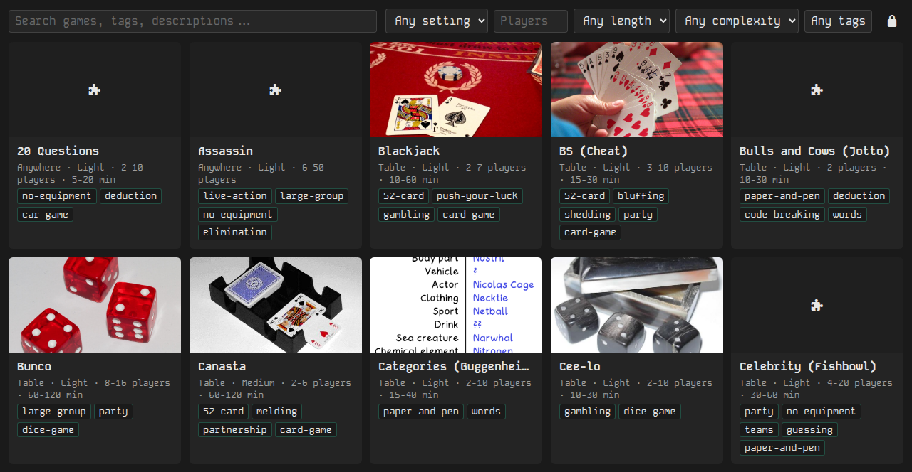
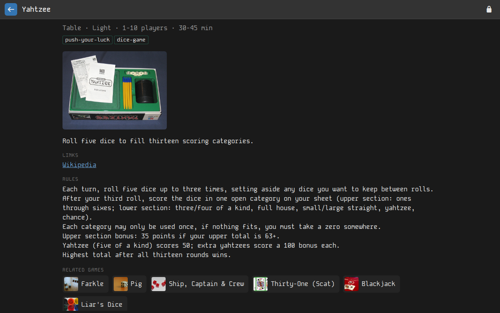
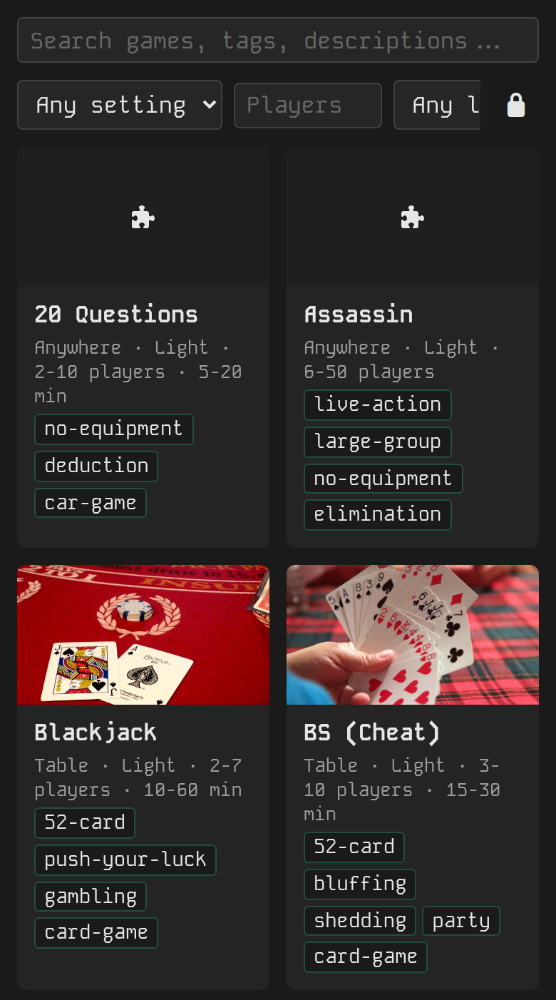

# game-night

A searchable library of games: 52-card classics, board games, video games, and homemade ones, built to answer "what should we play tonight?"



Five people and half an hour? Filter by player count, play time, setting (`Table` / `Couch` / `Outside` / `Anywhere`), complexity, tags, and fuzzy search across names, descriptions, and tags. Filter state lives in the URL, so a filtered view is shareable.

Every game gets its own page:

- **Rules & description**: markdown, with tables, `[!NOTE]` alerts, and a side-by-side live editor
- **Pictures**: shown on the card and in a detail gallery
- **Attachments**: rulebook pdfs, reference txt/md files
- **Links**: one per line, optionally labeled (`Label | https://...`)
- **Related games**: pin them by name, the rest are suggested by tag overlap





A fresh install seeds itself with 60+ ready-to-play classics, rules included, covers fetched in the background. Own a Steam library? Once unlocked, import it from the add button (+) with a Steam Web API key and your Steam id, vanity name or profile url: covers, descriptions, and genre tags land automatically.

## Usage

```sh
bun i
bun run dev # development on http://localhost:8034
bun start   # production
bun test
```

`bun i` also builds the client (`vbc-build`, into `client/build`). In development the server rebuilds it on change and reloads open pages; type `b` (or `build`) in its terminal to rebuild by hand, or `stop` to end it.

Data lives in `~/.gameNight.json` (override with `--database`); pictures and attachments in a sibling `~/.gameNight-files/` folder. Default port is `8034` (override with `--port`).

## Who can change what

Anyone on the network can browse, search, and read. Adding, editing, and deleting need an admin password, entered once per device through the padlock in the toolbar.

Set it with `--password` or `GAME_NIGHT_PASSWORD`. Leave it unset and the first run generates one and prints it to the console, once:

```sh
bun start --password 'something only you know'
```

Only the argon2 hash is stored. Changing the password logs every device out.

Run it as a background service:

```sh
bun run service:enable  # systemd user unit on linux, launchd agent on macos
bun run deploy          # rebuild and restart the service after pulling changes
```

The service comes from the component library's `vbc-service`. On macOS its agent is labelled `com.vanilla-bean.game-night`; a Mac still running the old `com.justfatlard.game-night` agent unloads that first (`launchctl unload ~/Library/LaunchAgents/com.justfatlard.game-night.plist`).

## Stack

- [Bun](https://bun.sh) server on the component library's app kit (`serve`, `requestMatch`, `crudRoutes`, `handleExit`, `devConsole`)
- [lowdb](https://github.com/typicode/lowdb) JSON database, through the app kit's `openDatabase` and `createStore`
- [@vanilla-bean/components](https://www.npmjs.com/package/@vanilla-bean/components) UI
- [@vanilla-bean/hypertether](https://www.npmjs.com/package/@vanilla-bean/hypertether) client data layer, re-exported by the component library (the games are a `resource()`; `failureReason()` words a failed load)
